# SHEild

**Your safety. Your story. Your next step.**

SHEild is a privacy-conscious cyber-safety companion for someone dealing with online abuse. It brings six connected screens together: documenting an incident, reviewing evidence, understanding the case as a whole, preparing an editable report, planning practical next steps, and finding emotional support.

This is a **hackathon prototype**, not a production safety service. It stores real data in MySQL and real files on disk, but its authentication, encryption, AI, and reporting integrations are deliberately limited and disclosed below.

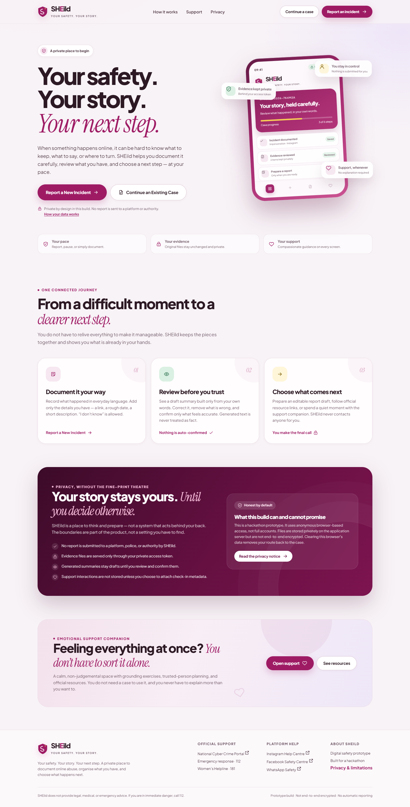

## At a glance

| Item | Detail |
| --- | --- |
| Type | Hackathon prototype |
| Screens | 6 connected screens |
| Backend | Java 17 target, Spring Boot 3.5.16, Spring Data JPA, Hibernate 6.6, Flyway |
| Database | MySQL 8 |
| Frontend | Vanilla HTML, CSS, and JavaScript modules; Fetch API; hash-based SPA routing |
| Authentication | Anonymous browser token; only a SHA-256 hash is stored server-side |
| AI | None configured; summaries and support replies are deterministic rule-based text |
| Reporting | No automatic submission to platforms, police, or authorities |
| Live demo | None configured in repository; run locally with Docker Compose or Maven |
| Tests | 4 backend integration tests and a Playwright browser end-to-end flow |
| Last verified | 25 October 2026 |

## The problem

When harassment, impersonation, or image-based abuse happens online, the next steps are scattered across platform help pages, screenshots, notes, and advice. People are often asked to retell the same story repeatedly, and tools sometimes imply that an algorithm has verified facts or filed a report when it has not.

SHEild takes the opposite approach:

- **The person stays the author.** Generated summaries are drafts, clearly labelled, and must be reviewed and confirmed.
- **Nothing is submitted automatically.** There is no integration that files a report, contacts a platform, or alerts the police.
- **Evidence is handled separately from interpretation.** Original files are kept unchanged; automatic OCR is not configured.
- **Support is available without a case.** The companion can be used before anything is saved.
- **The limits are visible.** The UI and this README describe what the prototype does and does not do.

## The six screens

| Screen | What it does |
| --- | --- |
| **Welcome and safety** | Explains the product, privacy boundaries, and connected journey. Starts a new case or reopens one saved in this browser. |
| **Report an incident** | Records incident type, platform, links, approximate time, description, impact notes, and optional evidence files. Saves drafts. Unsaved form data is preserved in browser storage across navigation. |
| **Evidence review** | Lists private files, supports authenticated preview, download, and delete, generates a rule-based draft summary, lets the person edit and confirm it, and shows when a review is confirmed. |
| **Case dashboard** | Aggregates incidents, evidence, confirmed reviews, documented links, possible connections, checklist progress, and drafts. Downloads a plain-text case summary. |
| **Take action** | Shows suggestions based on saved data, generates an editable report draft from a confirmed incident, tracks a persistent six-step checklist, and opens verified official resources in a new tab. |
| **Emotional support** | A guided, non-AI check-in with grounding, trusted-person planning, official resources, and optional check-in metadata attached to a case. |

Support is reachable from every screen through the persistent sidebar, mobile navigation, and contextual links.

## Screenshots

| Case dashboard | Evidence review |
| --- | --- |
| 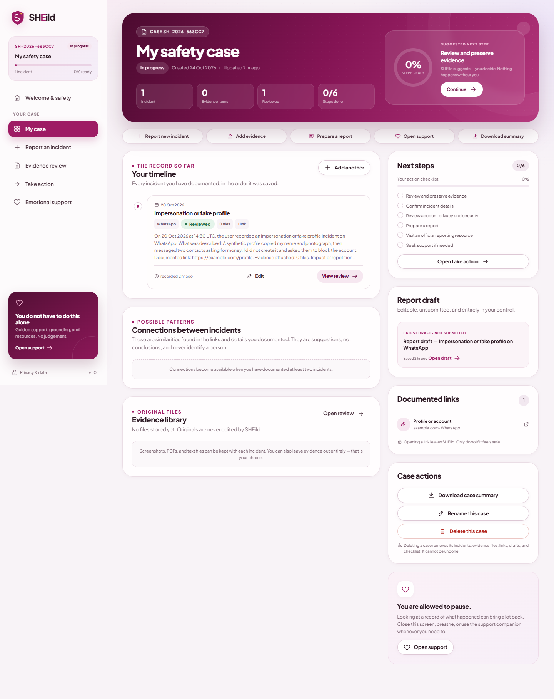 | 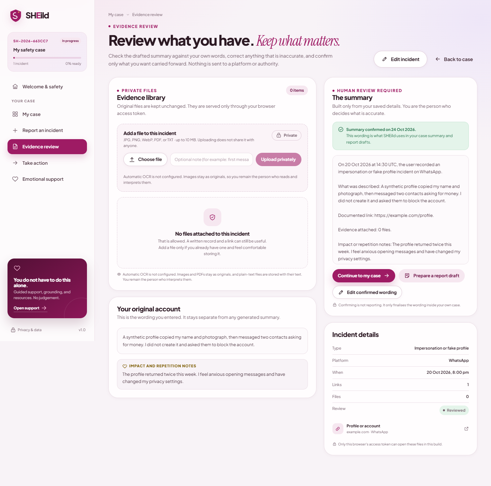 |

| Take action | Emotional support |
| --- | --- |
| 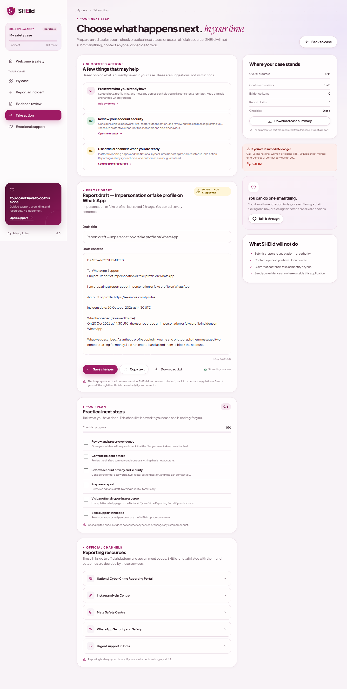 | 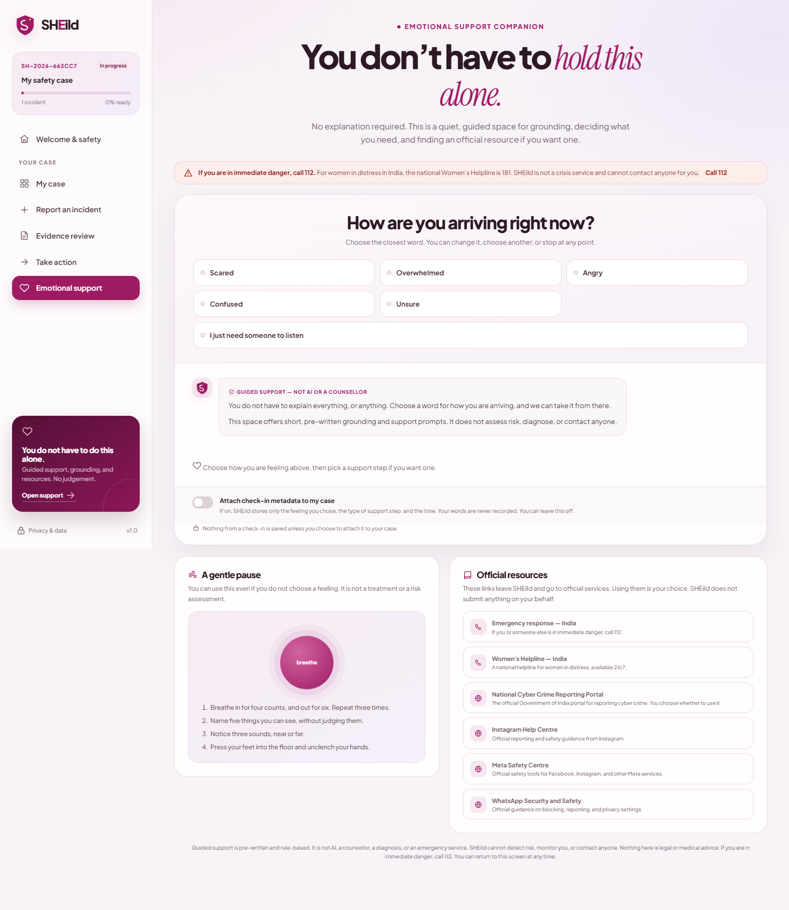 |

| Report an incident | Post-update continuation |
| --- | --- |
| 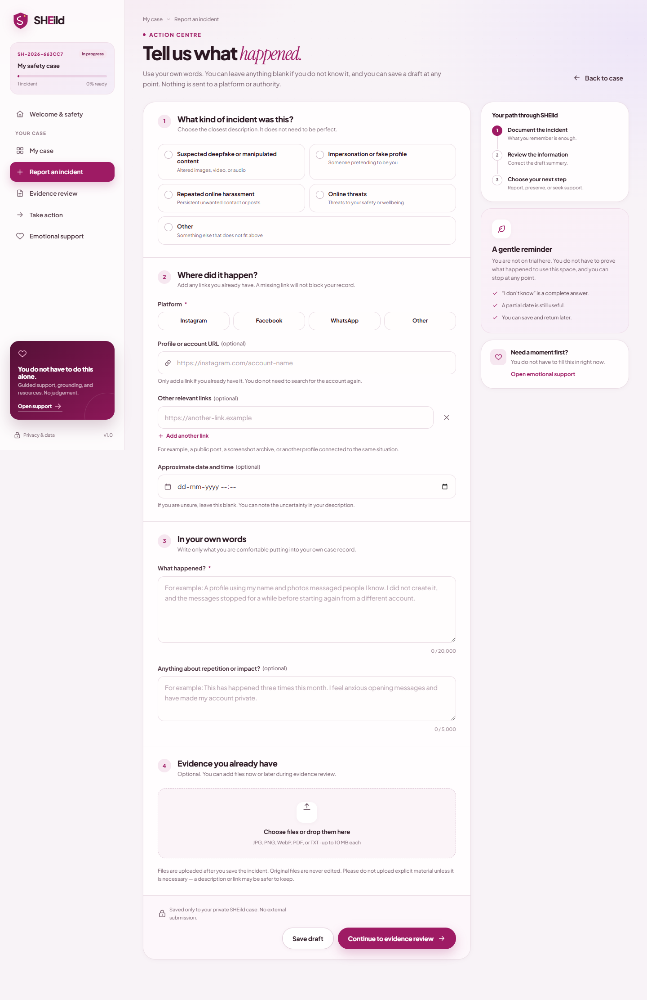 | 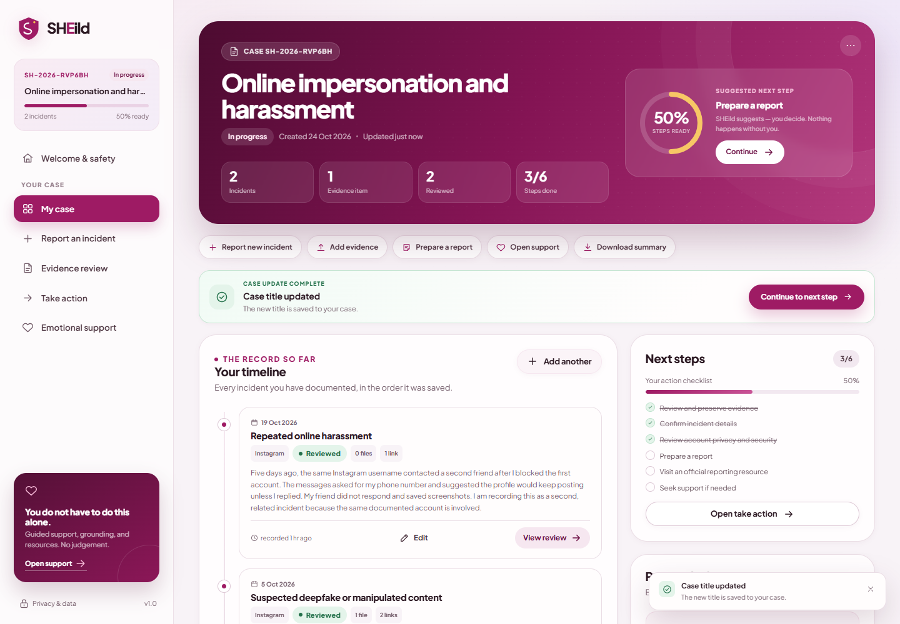 |

| Official reporting channels |
| --- |
| 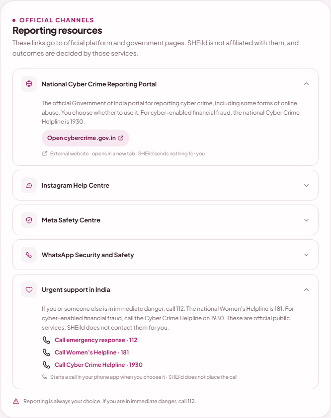 |

All six screens were checked at 1440, 1180, 1024, 768, and 390 px with no page-level horizontal overflow. Mobile layouts were checked at 390 x 844:

| Dashboard | Evidence review | Take action | Support |
| --- | --- | --- | --- |
| 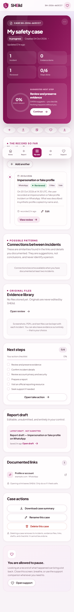 | 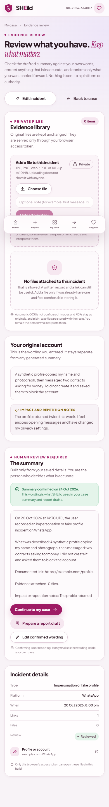 | 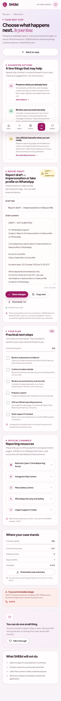 | 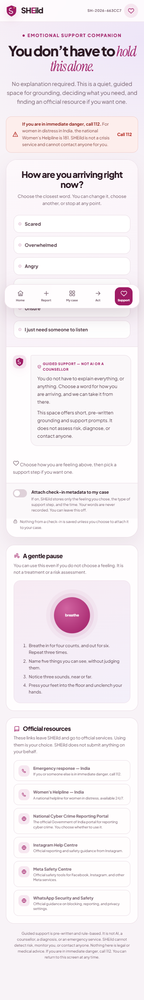 |

## What is real in this build

- **Spring Boot REST API** with Spring Web, Spring Data JPA, Hibernate, Spring Validation, Flyway, and MySQL.
- **Persistent records** for cases, incidents, documented URLs, evidence metadata, incident connections, report drafts, checklist items, support metadata, and anonymous browser sessions.
- **Private file handling**: uploads are validated, size-limited, stored outside the static web root, and downloaded only through an authenticated endpoint.
- **Access isolation**: every case-scoped request checks that the anonymous token owns the case. Another valid token receives `404` rather than learning that the case exists.
- **Real dashboard aggregation and summary export** generated from saved records.
- **Six responsive screens** in vanilla HTML, CSS, and JavaScript using the Fetch API, with hash routing and no frontend framework.
- **Clear post-update continuation**: a single success panel with one **Continue** action appears only after a save, upload, review confirmation, checklist change, rename, or connection decision succeeds. It preserves the current case and browser session.
- **Mobile layout** with a bottom navigation bar and responsive forms, cards, and tables.
- **Official channels stay external and explicit**: the reporting-resource list links only to Government of India and platform help pages, opens them in a new tab with `noopener noreferrer`, and states that SHEild sends nothing. Public emergency and support numbers use `tel:` links and state that the user's phone app starts the call.
- **Automated tests**: four Spring Boot/MockMvc integration tests against MySQL, plus a Playwright browser flow that covers the full case journey, each Continue-producing update path, every official external destination, the resource-jump action, phone disclosures, and responsive overflow.

## Honest limitations

These are intentional boundaries of the prototype, not hidden caveats.

1. **No full authentication.** Access uses a random token generated in the browser and stored in `localStorage`; only its SHA-256 hash is stored in MySQL. There is no password, account recovery, device management, or audit log. Anyone with access to the same browser profile may open the case. Clearing browser storage removes the only route back to the case.
2. **No encryption at rest or end-to-end encryption.** Evidence files sit in a local directory. The database and filesystem are not encrypted by SHEild. Use synthetic or non-sensitive material when exploring the demo.
3. **No AI provider is configured.** Summaries, suggestions, connections, and support replies are deterministic, rule-based text assembled from saved data. The interface labels them as guided or rule-based and never claims that an AI model analysed the files.
4. **No OCR or media analysis.** Images and PDFs remain originals. Plain-text files are stored as text for the person to read; the application does not interpret image contents.
5. **No automatic reporting.** SHEild never files a report, sends an email, contacts a platform, or notifies authorities. Report drafts are text the person can copy or download and submit themselves.
6. **Connections are suggestions, not conclusions.** They are based on exact normalised link matches between incidents. They do not identify people or prove a link.
7. **No legal, medical, or emergency response service.** The app cannot contact anyone for the user. It lists public emergency numbers (`112`), the national women's helpline (`181`), the cyber-crime financial-fraud helpline (`1930`), and official platform or cyber-crime links. Opening a link or tapping a phone number is a user action.
8. **Prototype operations.** There is no backup, retention policy, rate limiting, malware scanning, or production monitoring. Flyway manages the schema, but operational hardening is out of scope.

## Demo workflow

A concise five-minute path, based on the included demo plan:

1. Open the app and confirm `GET /api/health` returns `database: ok`.
2. Start a new case and report one synthetic incident.
3. Attach a small synthetic text file and continue to evidence review.
4. Read, edit, and confirm the rule-based summary.
5. Open the dashboard and download the case summary.
6. Generate and save an editable report draft; tick one checklist item.
7. Open emotional support, choose a feeling, and show the trusted-person plan.
8. Close by returning to the dashboard and stating that SHEild does not file or send anything.

Use synthetic, non-sensitive data only. If the live demo fails, use the screenshots in `docs/screenshots/` and the testing record.

## Architecture

```text
src/main/java/com/sheild
├── config/       security headers and MVC interceptor registration
├── controller/   REST endpoints for sessions, cases, incidents, evidence, drafts, checklist, support
├── domain/       enums and status values
├── dto/          request/response records and validation annotations
├── entity/       JPA entities
├── repository/   Spring Data JPA repositories
├── security/     bearer-token interceptor and token hashing
├── service/      access checks, business rules, storage, aggregation, mapping
└── web/          consistent API errors and exception handling

src/main/resources
├── db/migration/V1__init.sql   Flyway schema
└── static/                     the SPA, design system, fonts, and icons
```

Request flow: browser -> static SPA -> `fetch` with bearer token -> `AuthInterceptor` -> controller -> service (ownership check and rules) -> repository -> MySQL or evidence directory.

### Data model

```text
users (anonymous browser sessions)
  └── safety_cases
        ├── incidents
        │     ├── documented_urls
        │     ├── evidence
        │     ├── report_drafts
        │     └── incident_connections
        ├── checklist_items
        └── support_interactions (opt-in check-in metadata only)
```

## API overview

All `/api/**` routes except `/api/session` and `/api/health` require `Authorization: Bearer <token>`.

| Method and path | Purpose |
| --- | --- |
| `GET /api/health` | Database-aware health check |
| `POST /api/session` | Create an anonymous browser session |
| `GET /api/session/me` | Read current session metadata |
| `GET/POST /api/cases` | List or create cases |
| `GET/PUT/DELETE /api/cases/{id}` | Read, rename, or delete a case |
| `GET /api/cases/{id}/dashboard` | Aggregated case view |
| `GET/POST /api/cases/{id}/incidents` | List or create incidents |
| `GET/PUT /api/incidents/{id}` | Read or update an incident |
| `POST /api/incidents/{id}/review` | Generate a rule-based draft review |
| `PUT /api/incidents/{id}/confirmed-summary` | Confirm the person's reviewed wording |
| `POST /api/incidents/{id}/evidence` | Upload a private evidence file |
| `GET /api/incidents/{id}/evidence` | List evidence for an incident |
| `GET /api/evidence/{id}` | Read evidence metadata |
| `GET /api/evidence/{id}/file` | Authenticated file preview or download |
| `DELETE /api/evidence/{id}` | Delete an evidence item |
| `GET /api/cases/{id}/urls` | List documented URLs |
| `GET /api/cases/{id}/connections` | List possible documented-link connections |
| `POST /api/connections/{id}` | Record a connection decision |
| `GET /api/cases/{id}/checklist` | Read checklist progress |
| `PUT /api/checklist/{itemId}` | Update checklist progress |
| `GET /api/cases/{id}/report-drafts` | List report drafts |
| `POST /api/incidents/{id}/report-drafts` | Generate an editable draft |
| `PUT /api/report-drafts/{id}` | Save draft edits |
| `GET /api/cases/{id}/summary` | Download a plain-text case summary |
| `POST /api/support/respond` | Get guided support content, optionally storing check-in metadata |

Errors use a consistent JSON shape with `timestamp`, `status`, `error`, `message`, `path`, and optional field errors.

## Privacy and security measures actually implemented

- Random 32-byte bearer token generated per browser session; only a SHA-256 hash is stored server-side.
- Ownership checked on every case, incident, evidence, draft, and checklist operation. Unauthorised case access returns `404`.
- Evidence stored outside `src/main/resources/static`; the filename is generated server-side; the original name is metadata only.
- Allowed types: JPG/JPEG, PNG, WebP, PDF, and plain text. Maximum 10 MB. Content type validated against the extension allow-list.
- Downloads set `Cache-Control: private, no-store` and `X-Content-Type-Options: nosniff`.
- Security headers include CSP, `X-Frame-Options: DENY`, `Referrer-Policy`, and a restricted `Permissions-Policy`.
- All user text is escaped in the SPA. URLs are normalised and limited to HTTP(S).
- Input length limits are enforced on both the client and the server with Spring Validation.
- Deleting a case removes its dependent records and its evidence files.

These measures do not replace production authentication, encryption, malware scanning, backups, or monitoring.

## Running the app

### Option A: Docker Compose (recommended for a clean demo)

Requires Docker Desktop or Docker Engine with Compose.

> The Docker path is included for portability but was **not exercised** in the verification environment because Docker was not installed. The local MySQL and Maven path and the automated tests below were run successfully. Please smoke-test `docker compose up --build` once on the demo machine.

Windows PowerShell:

```powershell
Copy-Item .env.example .env
# Edit .env and choose non-default database passwords.
docker compose up --build
```

macOS or Linux:

```sh
cp .env.example .env
# Edit .env and choose non-default database passwords.
docker compose up --build
```

Open <http://localhost:8080>. MySQL is exposed on host port `3307`; the application connects to the `db` service internally. Evidence files and the database live in named volumes.

To stop:

```sh
docker compose down
```

To remove all persisted demo data as well:

```sh
docker compose down -v
```

### Option B: Local MySQL and Maven

Prerequisites: JDK 17 or newer and MySQL 8. Maven is not required because the wrapper is included.

1. Create the database and application user. Replace the password in a real environment.

   ```sql
   CREATE DATABASE shield CHARACTER SET utf8mb4 COLLATE utf8mb4_unicode_ci;
   CREATE USER 'shield'@'%' IDENTIFIED BY 'shield_dev_password';
   GRANT ALL PRIVILEGES ON shield.* TO 'shield'@'%';
   FLUSH PRIVILEGES;
   ```

   The default credentials above are development examples only. Replace them before any shared or production use.

2. Start the app with defaults for a local MySQL instance on port `3307`:

   Windows PowerShell:

   ```powershell
   .\scripts\run-local.ps1
   ```

   macOS or Linux:

   ```sh
   ./scripts/run-local.sh
   ```

   Or set the environment variables yourself and run:

   Windows PowerShell:

   ```powershell
   $env:DB_URL='jdbc:mysql://127.0.0.1:3307/shield?useSSL=false&allowPublicKeyRetrieval=true&serverTimezone=UTC&characterEncoding=utf8'
   $env:DB_USERNAME='shield'
   $env:DB_PASSWORD='shield_dev_password'
   $env:SHEILD_STORAGE_DIR='C:\path\to\data\evidence'
   .\mvnw.cmd spring-boot:run
   ```

   macOS or Linux:

   ```sh
   export DB_URL='jdbc:mysql://127.0.0.1:3307/shield?useSSL=false&allowPublicKeyRetrieval=true&serverTimezone=UTC&characterEncoding=utf8'
   export DB_USERNAME='shield'
   export DB_PASSWORD='shield_dev_password'
   export SHEILD_STORAGE_DIR='/path/to/data/evidence'
   ./mvnw spring-boot:run
   ```

3. Open <http://localhost:8080>. Flyway creates or validates the schema on startup.

Configuration variables:

| Variable | Default | Purpose |
| --- | --- | --- |
| `PORT` | `8080` | HTTP port |
| `DB_URL` | local MySQL on `3307/shield` | JDBC connection |
| `DB_USERNAME` | `shield` | Database user |
| `DB_PASSWORD` | `shield_dev_password` | Database password, development example only |
| `SHEILD_STORAGE_DIR` | `./data/evidence` | Private evidence directory |
| `SHEILD_MAX_EVIDENCE_BYTES` | `10485760` | Per-file limit (10 MB) |

All default database credentials in this section are development examples. Replace them before any shared or production deployment.

## Tests

The integration tests use a **separate database** so they do not touch demo data. Create it once:

```sql
CREATE DATABASE shield_test CHARACTER SET utf8mb4 COLLATE utf8mb4_unicode_ci;
GRANT ALL PRIVILEGES ON shield_test.* TO 'shield'@'%';
FLUSH PRIVILEGES;
```

Then run:

Windows PowerShell:

```powershell
.\mvnw.cmd test
```

macOS or Linux:

```sh
./mvnw test
```

The suite covers:

- session creation and bearer authentication;
- case creation, incident creation, URL normalisation, and validation errors;
- authenticated evidence upload, private download, and rejection of an unsafe file type;
- rule-based review generation, summary confirmation, and aggregate case state;
- report draft generation and editing;
- checklist persistence and dashboard aggregation;
- text summary download with the "not a report" disclosure;
- cross-token case isolation (`404`) and missing or invalid tokens (`401`);
- support response labelling and opt-in metadata behaviour.

The Playwright browser end-to-end test was run separately against the demo server and is not part of the Maven test lifecycle because it requires a running app and browser. It verifies Continue panels after draft save, incident save, evidence upload and delete, review confirmation, dashboard rename, draft save, checklist update, and connection decision. It also expands the reporting-resource section, verifies the official destination of every external channel, checks phone disclosures, and sweeps all six screens at 1440, 1180, 1024, 768, and 390 px for horizontal overflow. Test results are recorded in [docs/TESTING.md](docs/TESTING.md).

Windows PowerShell:

```powershell
cd tests/ui
npm install
$env:CHROME_PATH='C:\Program Files\Google\Chrome\Application\chrome.exe'
npm run e2e
```

macOS or Linux:

```sh
cd tests/ui
npm install
CHROME_PATH=/path/to/chrome npm run e2e
```

Build without tests:

Windows PowerShell:

```powershell
.\mvnw.cmd -DskipTests package
```

macOS or Linux:

```sh
./mvnw -DskipTests package
```

## Verification status

Verified locally on 25 October 2026:

- Backend integration tests: `Tests run: 4, Failures: 0, Errors: 0, Skipped: 0` (BUILD SUCCESS).
- Browser end-to-end test: `E2E PASS`, `ISSUES []`.
- Official-channel test: every external destination and phone disclosure passed.
- Responsive sweep: all six screens passed at 1440, 1180, 1024, 768, and 390 px with no page-level horizontal overflow.
- Final package rebuilt and health-checked after the latest UI fixes.

Docker Compose was not exercised because Docker was not installed in the verification environment.

## Technology

| Layer | Technology |
| --- | --- |
| Frontend | HTML5, CSS3, vanilla JavaScript modules, Fetch API, hash-based SPA routing, locally hosted fonts |
| Backend | Java 17 target, Spring Boot 3.5.16, Spring Web, Spring Data JPA, Hibernate 6.6, Spring Validation |
| Database | MySQL 8, Flyway migrations, Hibernate schema validation |
| Build | Maven 3.9.9 with Maven Wrapper |
| Tests | JUnit 5, Spring Boot Test, MockMvc, Playwright (Chromium/Chrome) |

The verified local runtime used Java 27 with a Java 17 target. Docker uses Temurin 17.

## Project documentation

- [Presentation outline](docs/PRESENTATION.md) - slide-by-slide story and technical talking points.
- [Demo plan](docs/DEMO.md) - a five-minute demo script with a fallback path.
- [Testing record](docs/TESTING.md) - automated and browser test coverage and known limitations.

## Branding

- Product name: **SHEild**
- Tagline: **Your safety. Your story. Your next step.**
- Palette: berry `#9E1B64`, soft lavender, white, and a warm yellow accent.
- Type: Plus Jakarta Sans and Instrument Serif italic, locally hosted for offline use.

## Licence and intended use

This repository is a hackathon prototype. It is not a substitute for legal advice, medical care, law enforcement, or a crisis service. If you or someone else is in immediate danger, call `112`. In India, the national women's helpline is `181`.

Please explore it with synthetic, non-sensitive data.